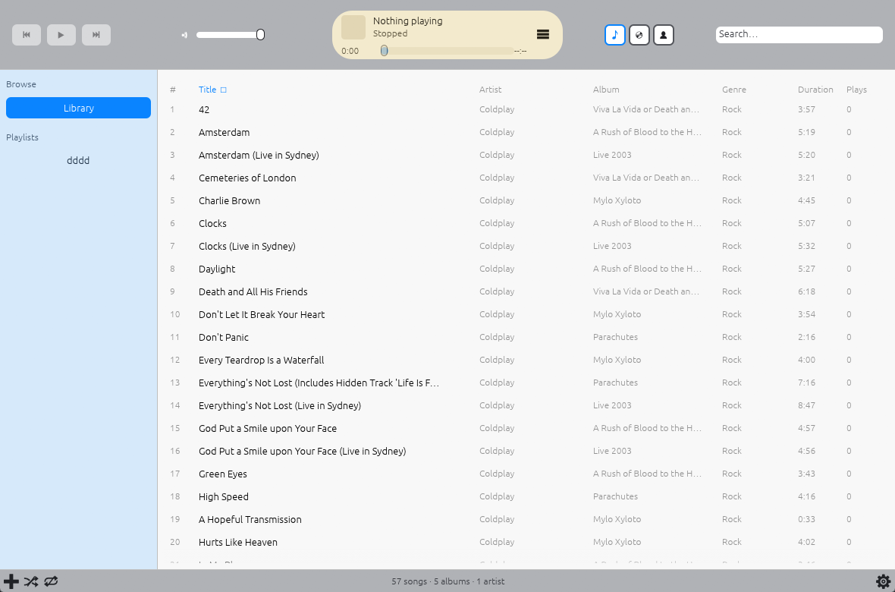
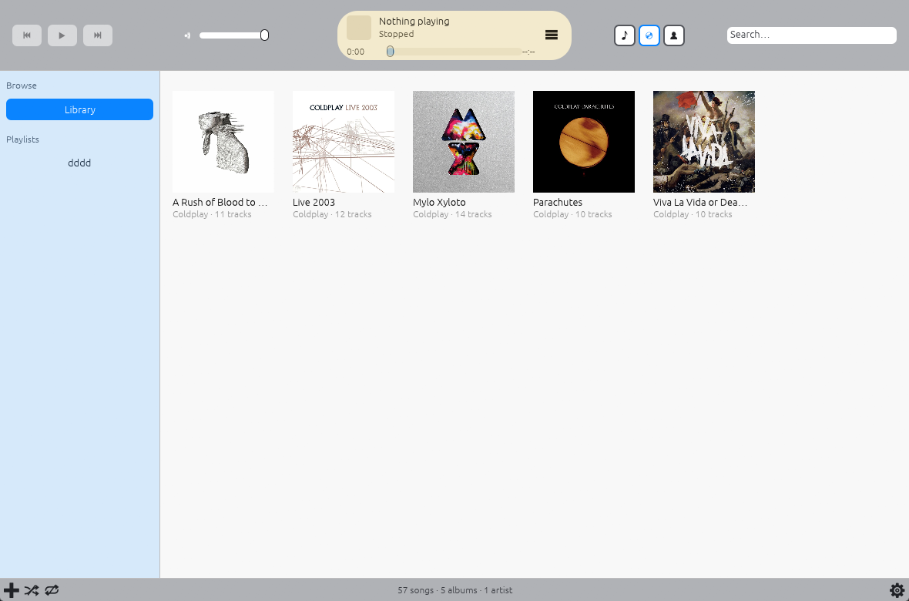

# iCraftMusic



A native desktop player inspired by [iTunes 11](#itunes-11-and-the-year-in-the-brief),
written entirely in Rust: a local library, album artwork, playlists, a queue, a
search field that is always a keystroke away, and one window with the navigation
on the left, the list in the middle and the player across the top.

**Written entirely in Rust** — every line of application code, from the audio
engine to the tag writer to the UI. The only non-Rust things in the tree are the
desktop entry and the icon a Linux package would install. There is no JavaScript
runtime and no web view anywhere in it.

The crate is named `musiccraft`.
[iCraftMusic](https://github.com/cmspeedau/iCraftMusic) — it is a music player,
and the name on the tin says so.

iCraftMusic is built incrementally against [ROADMAP.md](ROADMAP.md), which is the
authority on what each stage delivers and on what is still missing.
[ROADMAP-MEDIA.md](ROADMAP-MEDIA.md) is the second roadmap: movies, TV shows and
podcasts, with gPodder synchronization — and Apple iPod synchronization, whose
approach is not yet decided and which that file marks **Unknown** rather than
pretending otherwise.

## Status

| Stage | Description                         | State    |
| ----- | ----------------------------------- | -------- |
| 0     | Project Foundation                  | Complete |
| 1     | Desktop UI Shell                    | Complete |
| 2     | Audio Playback Engine               | Complete |
| 3     | Music Library and Metadata          | Complete |
| 4     | Functional Music Library UI         | Complete |
| 5     | Playlists and Queue Management      | Complete |
| 6     | Metadata Editing and Library Polish | Complete |
| 7     | Settings, Reliability, Performance  | Complete |
| 8     | Visual Refinement and Accessibility | Complete |
| 9     | Release and Distribution            | Planned  |
| 10    | Optional Future Enhancements        | Partial  |

Stage 10 collects features that are optional rather than prerequisites, and
three of them have been built: **gapless playback**, **crossfade** and a
**graphic equalizer**. Consecutive tracks whose order the queue already knows
change over with no silence between them, because the track that follows is
handed to the audio device before the current one ends and the hand-over is
reported from the audio itself. A crossfade length above zero blends the two
instead, overlapping them by that many seconds on the engine's two decks. The
equalizer is a ten-band peaking-filter bank with a preamp and presets, applied to
every track as it plays. The other additions the roadmap lists are not started.
See [ROADMAP.md](ROADMAP.md#stage-10--optional-future-enhancements) for the detail.

Beyond music, four further stages are planned in
[ROADMAP-MEDIA.md](ROADMAP-MEDIA.md):

| Stage | Description                          | State   |
| ----- | ------------------------------------ | ------- |
| 11    | Media Library Generalisation         | Planned |
| 12    | Movies and TV Shows                  | Planned |
| 13    | Podcasts and gPodder Synchronization | Planned |
| 14    | Apple iPod Synchronization           | Unknown |

The two roadmaps share one foundation: Stage 11 generalises the library and the
player so that a film, an episode and a podcast episode are rows beside a song
rather than a second application, and Stages 12 and 13 then add the surfaces
those rows need.

**Unknown** is a state of its own, not a shy way of writing Planned. Stages 11 to
13 each have an approach that has been thought through and only the work left;
Stage 14 does not. An iPod verifies a checksummed database against a hash that,
on the newer generations, cannot be derived without a file only iTunes can
produce — so writing to the device is a different class of operation from
anything else in this application, and there are three candidate approaches with
no obvious winner. [ROADMAP-MEDIA.md](ROADMAP-MEDIA.md) records the research and
the three open questions rather than inventing a plan to have one.

## What it plays

A scan indexes the music formats the bundled decoder can read. Everything else
is left alone: a text file, a cover image and a playlist in a watched folder are
not counted as music, and a music format this build cannot decode is counted and
named after a scan rather than passed over in silence.

### Music

| Format                    | Extensions              | Play | Read tags | Write tags | Tag block                                    |
| ------------------------- | ----------------------- | ---- | --------- | ---------- | -------------------------------------------- |
| MP3 (MPEG-1/2 Layer III)  | `.mp3`                  | Yes  | Yes       | Yes        | ID3v2                                        |
| FLAC                      | `.flac`                 | Yes  | Yes       | Yes        | Vorbis Comments                              |
| WAV                       | `.wav` `.wave`          | Yes  | Yes       | Yes        | ID3v2                                        |
| Ogg Vorbis                | `.ogg` `.oga`           | Yes  | Yes       | Yes        | Vorbis Comments                              |
| AAC / MP4 family          | `.m4a` `.mp4` `.aac`    | Yes  | Yes       | Yes        | MP4 `ilst` (`.m4a`, `.mp4`), ID3v2 (`.aac`)  |

Every format above reads a title, artist, album, album artist, genre, track and
disc number, duration and embedded cover art, and every one of them accepts a
write. A write is what **Write to file** in the metadata editor does, and it is
the only path in the application that changes a file; a file whose tags cannot
be written is refused with a message rather than written badly.

Recognised as music but not playable by this build, so a scan counts them and
names the formats:

| Extensions                                                                                            |
| ----------------------------------------------------------------------------------------------------- |
| `.aif` `.aiff` `.alac` `.ape` `.dff` `.dsf` `.mka` `.mpc` `.opus` `.ra` `.tak` `.tta` `.wma` `.wv`    |

Nothing else is a media file as far as iCraftMusic is concerned.

### Planned

| Media         | Stage | State   | Notes                                                             |
| ------------- | ----- | ------- | ----------------------------------------------------------------- |
| Movies        | 12    | Planned | Container demux, artwork, per-title grouping for a series          |
| TV shows      | 12    | Planned | Season and episode numbers, remembered next-episode position       |
| Podcasts      | 13    | Planned | RSS/Atom feed parsing, episode download, resume position           |
| gPodder sync  | 13    | Planned | Subscription and episode-action sync with gpodder.net or a self-hosted instance |
| Apple iPod sync | 14  | Unknown | Writing the device's checksummed database; approach undecided      |

The roadmap for these is [ROADMAP-MEDIA.md](ROADMAP-MEDIA.md), which also carries
the gPodder API reference those stages are written against.

Apple iPod sync is the one entry here with no agreed approach, and it is listed
as **Unknown** rather than Planned for that reason. An iPod reads a database of
what is on it, and since the iPod classic that database is verified against a
cryptographic hash — so a sync means rewriting the database and recomputing the
hash, and on the newer generations that hash depends on a `HashInfo` file only
iTunes can generate. Three approaches are on the table (bindings to the C
`libgpod`, a from-scratch Rust implementation of the format, or export-only and
never write to the device); the trade-offs, the generation-by-generation
requirements and the open questions are written down in
[ROADMAP-MEDIA.md](ROADMAP-MEDIA.md#stage-14--apple-ipod-synchronization).

### The three Library pages

The Library browses the same rows three ways, and both of the pages below are
one keystroke from the sidebar: `Ctrl/⌘ 1` for All Tracks, `Ctrl/⌘ 2` for
Albums, `Ctrl/⌘ 3` for Artists.

**All Tracks** — the whole library as one sortable, filterable table:


**Albums** — one tile per album, with the cover the scanner cached, the artist
and the track count:



**Artists** — the artist list, which narrows the Library to one name when a row
is picked, the same way clicking an album tile does.

## Current functionality

| Area                  | What works                                                                                                          |
| --------------------- | ------------------------------------------------------------------------------------------------------------------- |
| Playback              | Play, pause, stop, seek, volume, previous and next; device, decoder and missing-file failures reported in place of the track detail |
| Gapless playback      | The queue lines up the next track's audio behind the current one, so consecutive tracks change over with no silence between them; the change-over is reported from the audio, not a frame late |
| Queue                 | Move a track earlier or later, remove it, clear the list, jump to any entry; shuffle and repeat                       |
| Library — All Tracks  | Sortable table (title, artist, album, genre, duration, plays) with click, ctrl-click and shift-click selection        |
| Library — Albums      | Album grid with cover art, decoded once per album and re-decoded when the texture cache fills                         |
| Library — Artists     | Artist list, virtualised like the track table                                                                        |
| Search                | Live filtering as the query is typed, over the rows already in memory; typing never touches the database              |
| Playlists             | Create, rename, copy and delete; add tracks from the Library's context menu; reorder entries; play the whole list, or from any row by double-click |
| Metadata editing      | Title, artist, album, album artist, genre, track and disc numbers, and the cover; save to the database or write the tags into the file |
| Play counts           | A **Plays** column, counted by the library rather than by the file, so a rescan does not reset it                     |
| Sorting and filtering | A leading article is ignored (`The Beatles` files under B); the table can be narrowed to tracks whose files have vanished |
| Keyboard              | Space, `Ctrl/⌘ ←/→/↑/↓`, `Ctrl/⌘ L/P/,/1/2/3/E`, `Delete` and `Esc`; Tab and the arrow keys walk a visible focus ring, and Enter acts on the row it rests on — the table, the albums, the artists, a playlist — as a double-click would; listed in Settings, and none fires while a text field has focus |
| Accessibility         | Every focusable control shows the ring, and every glyph-only button and slider gives a screen reader the words the pointer gets as hover text (`Repeat: this track`, not `🔁`) through AccessKit |
| Settings              | Theme, volume, watched folders, output device, the crossfade length and the equalizer, each persisted as it changes     |
| Diagnostics           | Build, schema version, library counts, exact paths, the audio stream in use, and an on-demand `PRAGMA integrity_check` |
| Recovery              | A versioned database copied beside itself (`VACUUM INTO`) before a migration rewrites it                             |
| Logging               | stderr and a rotated, bounded log file under the data directory                                                      |
| Packaging             | Release profile, desktop entry and SVG icon prepared under `packaging/`                                              |
| Updates               | One check of the releases API at startup; when a newer release than this build exists, the status bar says so and opens its page |

Known limitations: a scan can be stopped but is not resumed after the application
exits. Editing a track's details keeps them in the library until the file changes
or the tags are written into the file itself. A file played without being indexed
(the play field, or the command line) has no row to count a play against. Gapless
playback covers every track order the queue can name before the current track
ends, but an edit to the queue in the moment before a change-over — removing or
moving the track that was lined up — makes the player follow the queue with a
normal load, which can be heard as a short gap; this is the one case where a
change is not seamless. A crossfade is stepped on the frame clock rather than
per sample, so a fade is smooth but not exact; it also needs a track whose length
the decoder reported, and a track shorter than the fade finishes before the fade
does. The equalizer has ten fixed bands and one preset shape per band. There
is no installer and no release artifact yet; packaging is prepared under
`packaging/`, not finished. The update check is the only network request the
application makes: it sends nothing but this build's own name and version to the
releases API, and it stays silent — no notice at all — while no release has been
published, which is the case for this build. Nothing about the library, the
listening history or the machine is sent. These are deliberate and tracked in
the roadmap, not presented as finished features.

## iTunes 11, and the year in the brief

iTunes 11 shipped in **late 2012**; 2008 was the iTunes 8 era. iCraftMusic treats
11 as the visual reference because that is the release whose layout this window
is copying: the sidebar on the left, the content area in the middle, one bar
across the top carrying the transport and the cover of what is playing, and a
status strip along the foot. The album grid and the cover-driven centre box are
that release's idiom. What the two eras share, and what this project actually
follows, is the shape of the thing — a local library you own, browsed rather
than fed to you.

## Prerequisites

- Stable Rust toolchain (install via [rustup](https://rustup.rs)).
- A desktop session with GPU/OpenGL support (the UI uses `egui`/`eframe`).
- On Linux, the usual `eframe` system libraries, for example:

  ```sh
  # Debian/Ubuntu
  sudo apt install libxkbcommon-dev libgtk-3-dev libgl1-mesa-dev
  # Fedora
  sudo dnf install libxkbcommon-devel gtk3-devel mesa-libGL-devel
  ```

  Exact package names vary by distribution.

- The folder chooser in Settings → Library management is the desktop's own file
  dialog. On Linux that is `xdg-desktop-portal`, which every KDE/GNOME session
  already runs; if no portal is available the button reports the failure rather
  than opening nothing. The path field beside it always works.

## Build

```sh
cargo build            # debug build
cargo build --release  # optimized build
```

## Run

```sh
cargo run
```

The window opens with the navigation sidebar, content area, and playback bar.

## Quality checks

Run these before considering any change complete:

```sh
cargo fmt --check      # formatting
cargo check            # compile check
cargo clippy           # lints
cargo test             # unit tests
```

## Configuration

User settings are stored as TOML in the platform configuration directory
(`config.toml` under the OS-provided config path). A missing or malformed file
falls back to defaults rather than failing; save errors are surfaced in the top
bar instead of crashing.

What is stored: the theme, the volume, the folders the library watches, and the
output device iCraftMusic plays through (`output_device`, omitted entirely when
the system default is wanted). Changing any of them writes the file at the end
of the frame.

The library database, the cached cover art and the log live in the platform's
data directory, apart from the settings:

| Path (Linux)                                        | What it is                     |
| --------------------------------------------------- | ------------------------------ |
| `~/.config/musiccraft/config.toml`                   | preferences                    |
| `~/.local/share/musiccraft/library.sqlite`           | the indexed library            |
| `~/.local/share/musiccraft/logs/musiccraft.log`      | this run's log (and the one before it) |

Settings → Diagnostics shows the exact paths on your machine, the schema version
of the database, the counts, the audio stream in use, and a button that checks
the database. Set `RUST_LOG=musiccraft=debug` to make the log talkative.

## Library data and recovery

The database is a cache of what the files on disk say: removing a row never
deletes a file, and a rescan rebuilds what is missing. Nothing in the
application damages your music.

If the library misbehaves, Settings → Diagnostics → **Check the library
database** runs SQLite's own `PRAGMA integrity_check` and reports what it found
without changing anything. To rebuild from scratch:

```sh
# 1. Stop iCraftMusic, then move the database aside (the cover-art cache and the
#    music files are untouched).
mv ~/.local/share/musiccraft/library.sqlite* /tmp/library-broken/

# 2. Start iCraftMusic and press Rescan under Settings → Library management.
#    Every watched folder is indexed again from the files themselves.
```

Upgrading the schema never happens silently on top of your only copy: before a
migration rewrites a database written by an older build, iCraftMusic writes a
consistent copy beside it with SQLite's `VACUUM INTO`:

```
library.sqlite.pre-v2.bak
```

If an upgrade goes wrong, that file is the library as the previous version left
it — move it back to `library.sqlite` and start the older build.

## Packaging

A release build and what a package needs:

```sh
cargo build --release
# → target/release/musiccraft

install -Dm755 target/release/musiccraft ~/.local/bin/musiccraft
install -Dm644 packaging/musiccraft.desktop \
    ~/.local/share/applications/musiccraft.desktop
install -Dm644 packaging/musiccraft.svg \
    ~/.local/share/icons/hicolor/scalable/apps/musiccraft.svg
update-desktop-database ~/.local/share/applications  # optional, for MimeType
```

`packaging/` holds the parts a distribution package would install:

- `musiccraft.desktop` — the desktop entry (name, categories, MIME types, and
  the `StartupWMClass` that ties the window to its launcher icon).
- `musiccraft.svg` — the icon, in plain SVG so a packager can rasterise whatever
  sizes the icon theme asks for.

The release profile in `Cargo.toml` builds one stripped binary with link-time
optimisation. There is no installer, and no artifact is published yet — that is
Stage 9's job; what is here is the preparation for it.

## Project layout

```
docs/
├── screenshot.png     # the Library's All Tracks table
└── albums.png         # the Library's Albums grid

ROADMAP.md             # music: stages 0–10
ROADMAP-MEDIA.md       # movies, TV shows and podcasts: stages 11–13

src/
├── main.rs            # binary entry point
├── lib.rs             # library root
├── app.rs             # application state and eframe glue
├── config.rs          # settings model and persistence
├── diagnostics.rs     # what the installation looks like, and the integrity report
├── error.rs           # typed errors (thiserror) and Result alias
├── logging.rs         # tracing subscriber: stderr and a rotated log file
├── audio/             # output device, queue, transport
├── library/           # models, scanning, tag reading and writing, browse state
├── database/          # SQLite schema and repository
├── playlists/         # playlists and their membership
├── search/            # pure query, sort and filtering over library rows
└── ui/
    ├── mod.rs         # shell composition
    ├── navigation.rs  # sidebar sections and the playlist list
    ├── theme.rs       # light/dark theming, the focus ring, and accessible names
    ├── libraryview.rs # library view: tracks, albums, artists
    ├── editview.rs    # the metadata editor
    ├── dialog.rs      # confirmation for destructive library actions
    ├── shortcuts.rs   # playback and navigation keys
    ├── nowplaying.rs  # playback bar
    ├── queueview.rs   # the queue popover
    ├── playlistview.rs# the open playlist and its tracks
    ├── playlistedit.rs# the playlist name editor
    ├── settingsview.rs# settings view
    └── statusbar.rs   # the bar across the foot of the window
```

## License

See [LICENSE](LICENSE).
